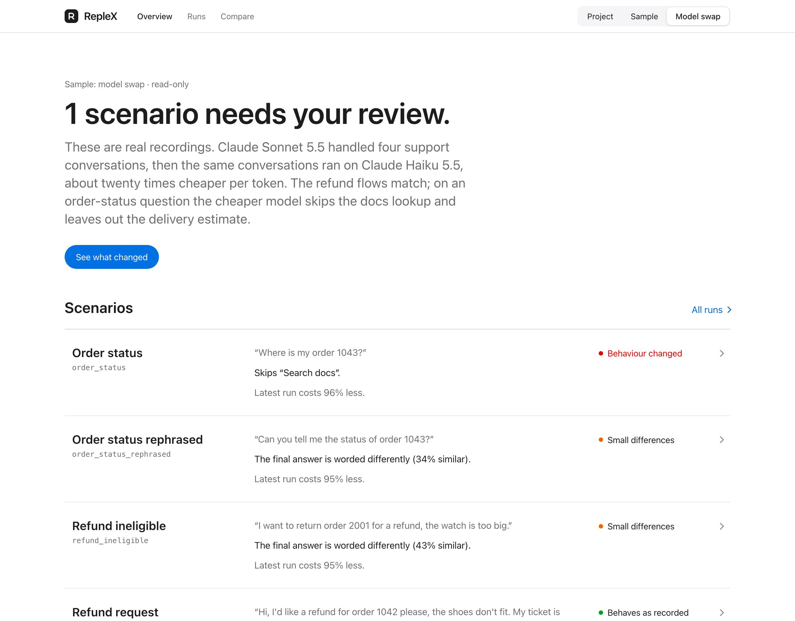
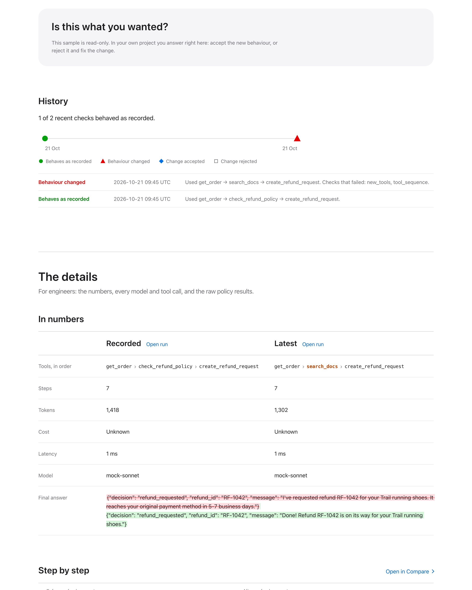

# RepleX

[](https://github.com/AshishKalidas/replex/actions/workflows/ci.yml)

**Know when your AI agent starts behaving differently, before your users do.**

RepleX records what your agent does (every model call and every tool call) and turns those
recordings into tests that run offline, for free, in milliseconds. When you change a prompt,
swap a model or refactor your code, it runs the same scenarios again and tells you, in plain
language, what the agent now does differently, what that costs, and whether you want to keep it.



## Why I built this

Agent changes that look harmless often aren't, and nothing tells you.

Take a support agent and reword its system prompt to sound friendlier. That one-line edit can
quietly stop it checking the refund policy before it issues refunds. Every test still passes
and the answers still read well. You find out when a customer gets a refund they were not
entitled to. That is the failure I wanted to catch before it ships, and it is exactly what the
sample in this repository shows.

The underlying problem is that agents are hard to test:

- **Runs aren't repeatable.** The same input takes a different path tomorrow, so you can't
  replay a bad run to debug it.
- **Tests are slow, flaky and cost money.** Every run calls a paid API over the network, so
  people stop running them.
- **Behaviour changes are invisible.** Asserting on the final text misses what actually
  matters: which tools the agent called, in what order, with which arguments.
- **Model choices are guesses.** "Can we move to the cheaper model?" is answered by feel,
  because nobody can see where the two models actually differ.

RepleX treats an agent run like a snapshot test. Record it once. Replay it offline on every
commit. After a change, compare the new behaviour with the recording under a policy you write,
and decide whether the difference is a regression or an improvement.

## Try it in one minute

You don't need an API key or any code of your own to see what RepleX does.

```bash
pip install "replex[console] @ git+https://github.com/AshishKalidas/replex"
replex console --sample
```

That opens two bundled workspaces, switched from the top bar:

- **Sample** is a customer-support agent whose prompt was reworded. RepleX caught that two of
  its four scenarios changed behaviour: it skips the refund-policy check and searches the docs
  instead. The first time you open it, a short tour walks you through what you are looking at.
- **Model swap** is real. Claude Sonnet 5.5 handled four support conversations; the same
  conversations then ran on Claude Haiku 5.5, which is about twenty times cheaper per token.
  The refund flows match. On "Where is my order?" the cheaper model skips the docs lookup, so
  it can no longer give a delivery estimate, and the run costs 96% less.



From a clone of this repository, `make demo` runs the whole loop for real, offline: it replays
the example's recordings, changes the prompt, catches the drift and writes an HTML report.

## What it does

- **Records and replays agents.** Model calls through `httpx`, `httpx2`, `requests` and
  `aiohttp` (which covers the official Anthropic and OpenAI SDKs, streaming or not) and your
  tool calls, saved as readable JSON. Replay uses no network and has no side effects.
- **Detects behavioural drift.** A YAML policy decides which differences fail, warn or are
  ignored: tool order, tool arguments, new or forbidden tools, answer wording, steps, tokens
  and cost.
- **Judges meaning, not wording.** An optional model-graded check asks whether two answers
  say the same thing. The verdict is itself recorded, so CI re-checks are free and
  deterministic.
- **Shows what a change costs.** Per-run cost from a price table (or the provider's own
  figure), and a policy check for cost regressions.
- **Measures consistency.** Run a scenario N times and see how many distinct paths the agent
  takes, and whether the recorded one is the majority.
- **Keeps history.** Every drift check and every accept or reject decision, so you can see
  when behaviour changed and when a change was accepted.
- **Explains itself.** A local console presents each scenario as a conversation: what the
  customer wrote, what the agent did and said before and after, then one question: is this
  what you wanted?
- **Runs without pytest.** Describe scenarios in a YAML suite and use `replex run`.
- **Reviews pull requests.** A GitHub Action posts the behaviour review as a PR comment.
- **Keeps secrets out.** Redaction happens before anything is written, and a CI check proves it.

## Use it on your own agent

**1. Install it in your project.**

```bash
pip install "replex[console] @ git+https://github.com/AshishKalidas/replex"
```

**2. Mark your tools and a test.** Your agent code doesn't change.

```python
import pytest
import replex

@replex.tool
def get_order(order_id: str) -> dict:
    return orders_db.fetch(order_id)

@replex.tool(safe=True)            # read-only, so it may run live during drift checks
def search_docs(query: str) -> list[str]:
    return docs_index.search(query)

@pytest.mark.replex(cassette="refund_request")
def test_refund_request(replex_session):
    answer = run_agent("I want a refund for order 1042")

    trace = replex_session.trace
    trace.assert_tool_sequence(["get_order", "check_refund_policy", "create_refund_request"])
    trace.assert_no_tool("delete_*")
```

No pytest? Put the scenarios in a file instead and run `replex run`; see
[docs/SUITES.md](docs/SUITES.md).

**3. Record once, with a real key.** Each scenario is saved as a readable JSON file in
`tests/cassettes/`, with API keys and personal data redacted before anything touches disk.
Commit it.

```bash
pytest --replex-mode=record
```

**4. Replay on every commit.** No network, no API costs, no tool side effects, and the same
result every time. This is what runs in CI.

```bash
pytest
```

**5. After a change, check for drift.** RepleX runs each scenario live again, records the
latest run next to the recorded one and compares them under your policy.

```bash
pytest --replex-mode=drift
```

**6. Review the changes.**

```bash
replex console
```

The console opens on your project: which scenarios changed and, for each one, the
conversation before and after your change, in plain language. Then it asks one question: is
this what you wanted? Accept it and commit the updated recording, or reject it and fix the
change. The numbers, the step-by-step diff and the history are there for the details.


## What a drift policy looks like

You decide which differences matter. Anything marked `fail` fails the test (and the CI job);
`warn` is reported for review.

```yaml
# replex.policy.yaml
version: 1
defaults:
  tool_sequence: {mode: exact, severity: fail}       # same tools, same order
  tool_args: {mode: exact, severity: fail, ignore_keys: [request_id]}
  new_tools: {severity: fail}                        # no tools the recording never used
  forbidden_tools: {patterns: ["delete_*", "send_payment"], severity: fail}
  final_output: {mode: similarity, threshold: 0.80, severity: warn}
  steps: {max_increase: 1, severity: warn}
  tokens: {max_increase_pct: 25, severity: warn}
  cost: {max_increase_pct: 20, severity: warn}
overrides:
  refund_request:
    final_output: {mode: json_schema, schema: schemas/refund.json, severity: fail}
```

Wording similarity is a weak proxy. To ask whether two answers *mean* the same thing, use the
judge: `final_output: {mode: judge, criteria: "Same decision and facts; tone may differ."}`.
Every check, with a passing and a failing example, is in [docs/DRIFT.md](docs/DRIFT.md).

## What real models did

The model-swap sample comes from real runs through OpenRouter. Reading the committed
recordings, with the same four scenarios each time:

| Run | Result against the Sonnet 5.5 recording |
|---|---|
| Sonnet 5.5, same prompt, run again | All four scenarios behave as recorded |
| Sonnet 5.5, friendlier prompt | Three of four change: it searches the docs instead of checking the refund policy. The refund *decisions* were still correct, so a test that only checks outcomes would have passed |
| Haiku 5.5, same prompt | Both refund flows match. Order status changes: no docs lookup, no delivery estimate |

Record your own with `make record-openrouter` (needs `OPENROUTER_API_KEY`) and compare models
with `make drift-openrouter MODEL=...`. See [docs/WALKTHROUGH.md](docs/WALKTHROUGH.md).

## In CI

Replay needs no secrets and runs on every push. A drift check calls the real model, so run it
nightly or on demand. The GitHub Action runs either, uploads the HTML report and posts the
behaviour review on the pull request:

```yaml
- uses: AshishKalidas/replex@main     # pin a tag or commit SHA in real use
  with:
    mode: replay
    install: pip install -e ".[test]"
```

Or run it yourself:

```bash
pytest                                          # every push: replay, offline
replex redact --check tests/cassettes           # every push: no secrets committed
pytest --replex-mode=drift                      # nightly: live check against the recordings
replex report tests/cassettes .replex/candidates --html replex-report.html
```

CI can never quietly replace your recordings: recording and accepting changes are refused when
`CI` is set. See [docs/CI.md](docs/CI.md).

## How secrets are handled

Redaction runs before a recording is written, never after.

- Auth headers, and any header or query parameter whose name contains `key`, `token` or
  `secret`, become `[REDACTED]`.
- Bearer tokens, provider API keys, email addresses and phone numbers in bodies become stable
  tokens such as `[REDACTED_EMAIL_1]`, so replay still matches.
- You add your own patterns and JSON paths in `[tool.replex]`.
- `replex redact --check` fails if anything slips through.

Details in [docs/REDACTION.md](docs/REDACTION.md).

## What it covers, and what it doesn't

- Replay checks **your code** against **recorded** model behaviour. It doesn't test the model;
  drift checks do that.
- Model calls are captured through `httpx`, `httpx2`, `requests` and `aiohttp` when installed.
  gRPC, WebSockets and calls from other processes are not captured.
- Tools are recorded when decorated with `@replex.tool` or wrapped with `replex.wrap_tools`.
- Anthropic Messages and OpenAI-compatible chat completions (OpenAI, OpenRouter and others) are
  understood natively, streaming or not; other APIs are recorded and replayed as raw exchanges.

More in [docs/LIMITATIONS.md](docs/LIMITATIONS.md).

## Documentation

| | |
|---|---|
| [Walkthrough](docs/WALKTHROUGH.md) | The example agent, the prompt change and the drift it causes, then a real prompt change and a real model swap |
| [Concepts](docs/CONCEPTS.md) | Recordings, traces, modes, matching and the Python API |
| [pytest](docs/PYTEST.md) | The marker, fixture, options and configuration |
| [Suites](docs/SUITES.md) | Scenarios in one YAML file, run with `replex run` instead of pytest |
| [Drift](docs/DRIFT.md) | Every policy check, the model-graded judge, the console and approving changes |
| [Cost](docs/COST.md) | Prices, the cost of each run and the cost drift check |
| [Consistency](docs/CONSISTENCY.md) | Run a scenario several times and see how often the agent takes each path |
| [History](docs/HISTORY.md) | How each scenario's drift checks and decisions evolve over time |
| [Redaction](docs/REDACTION.md) | Default rules, custom patterns and the check command |
| [Providers](docs/PROVIDERS.md) | Supported APIs, OpenRouter, the mock provider and adding your own |
| [CI](docs/CI.md) | A GitHub Actions workflow, and an action that reviews behaviour on pull requests |
| [Limitations](docs/LIMITATIONS.md) | What replay does and doesn't prove |
| [Decisions](docs/DECISIONS.md) | Design decisions and the reasons for them |

## Working on RepleX

```bash
git clone https://github.com/AshishKalidas/replex && cd replex
make install        # editable install with dev extras
make test           # full suite with a 90% coverage gate, plus the example's tests
make lint typecheck
make e2e            # the console in a real browser (Playwright)
make demo           # the whole workflow, offline, no key
make sample         # rebuild the console's bundled sample workspace
make build          # sdist and wheel in dist/, console included
make help           # every target
```

The console's front end lives in `console-ui/` (React and TypeScript); `make build-console`
rebuilds the copy that ships inside the package.

A decorated tool called outside a session costs about 70 ns (sync) and 100 ns (async) per
call on an Apple-silicon laptop (`make bench`; the release gate is 5 µs).

## Prior art

RepleX builds on the idea behind HTTP recorders such as
[VCR.py](https://github.com/kevin1024/vcrpy) and
[pytest-recording](https://github.com/kiwicom/pytest-recording), which made record-and-replay
"cassettes" a standard Python testing tool. What RepleX adds for agents: tool calls recorded and
replayed alongside model calls, one provider-neutral trace to assert on, behavioural drift
policies, and a review flow that shows changes as steps and tools rather than raw HTTP bodies.

## License

MIT. See [LICENSE](LICENSE).
