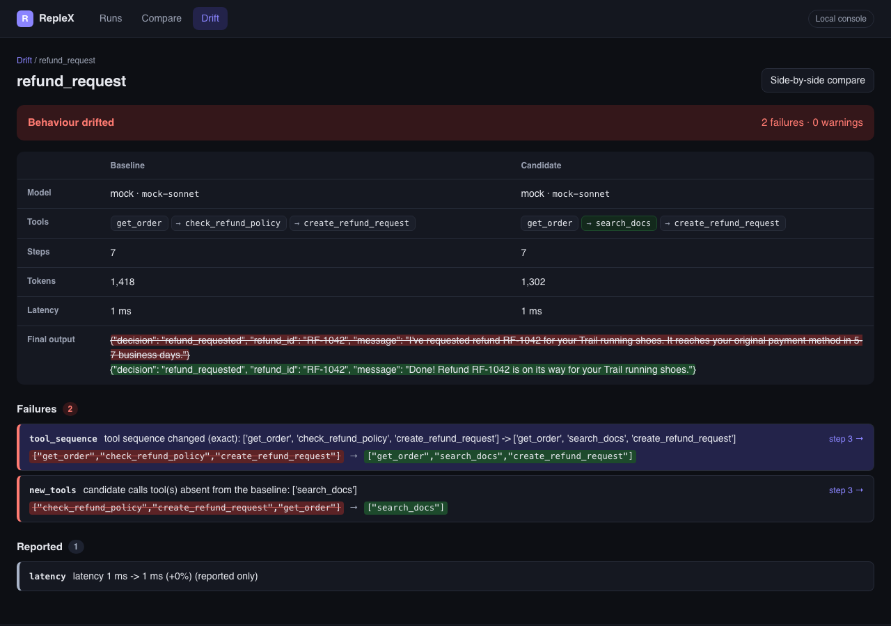
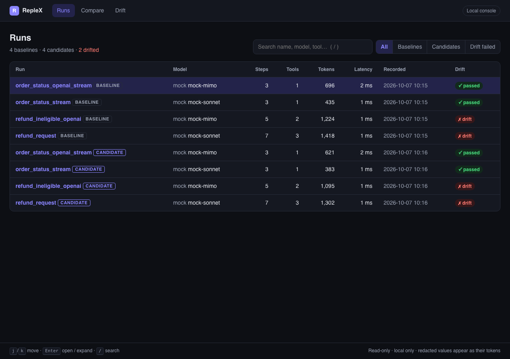
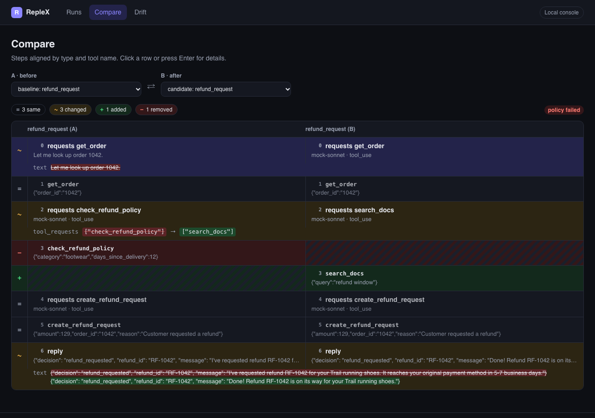

# RepleX

**Record-and-replay regression testing for AI agents.** Record an agent run once, replay it
offline forever, and fail CI when its behaviour drifts.

## The problem

Agents are hard to test because their runs are not repeatable. The same input gives a
different run tomorrow, so a bad run cannot be replayed to debug it. Every test calls a paid
API over the network, so tests are slow, flaky and expensive, and teams stop running them. And
when you edit a prompt or upgrade a model, nothing tells you what changed in *behaviour*: which
tools are now called, in what order, with which arguments.

RepleX treats an agent run like a snapshot test:

1. **Record** a run once: every model request and response, and every tool call and result,
   into a readable JSON file (a *cassette*) that lives in your repository.
2. **Replay** it offline: your agent code runs against the recorded responses with no network,
   no cost and identical results every time.
3. **Detect drift**: after a prompt or model change, run the scenario again, compare the new
   trace with the baseline under a written policy, and fail when behaviour moved too far.
4. **Inspect** runs and differences in a local console, or in a single-file HTML report that
   CI attaches to a pull request.

## Quick start (60 seconds)

RepleX is not on PyPI yet. Install it from a checkout (Python 3.10 to 3.13):

```bash
pip install -e ".[console]"
```

Decorate your tools and mark a test:

```python
import pytest
import replex

@replex.tool
def get_order(order_id: str) -> dict:
    return orders_db.fetch(order_id)

@replex.tool(safe=True)            # may run live during drift checks
def search_docs(query: str) -> list[str]:
    return docs_index.search(query)

@pytest.mark.replex(cassette="refund_request")
def test_refund_request(replex_session):
    answer = run_agent("I want a refund for order 1042")   # your agent, unchanged

    trace = replex_session.trace
    trace.assert_tool_sequence(["get_order", "check_refund_policy", "create_refund_request"])
    trace.assert_no_tool("delete_*")
    assert "refund" in answer.lower()
```

Record once with a real key, commit the cassette, and from then on the test replays offline:

```bash
pytest --replex-mode=record        # calls the model, writes tests/cassettes/refund_request.replex.json
git add tests/cassettes && git commit -m "Record refund baseline"
pytest                             # replay: no network, no key, no tool side effects
```

RepleX patches `httpx` while a session is active, so the official `anthropic` and `openai`
SDKs (and anything else built on `httpx`) are captured with no code changes.

Want to see the whole workflow without writing anything? `make demo` runs the bundled example
agent end to end with no API key.

## Record → replay → drift → approve

```text
$ pytest                                     # replay the baselines on every push
mode: replay | replayed: 4 | recorded: 0 | drift passed: 0 | drift failed: 0 | warnings: 0
8 passed, 1 skipped in 0.44s

$ PROMPT_VERSION=v2 pytest --replex-mode=drift    # a "small wording change" to the prompt
FAILED tests/test_support_agent.py::test_support_agent[refund_request]
FAILED tests/test_support_agent.py::test_support_agent[refund_ineligible_openai]
mode: drift | replayed: 0 | recorded: 0 | drift passed: 2 | drift failed: 2 | warnings: 1

$ replex drift cassettes/refund_request.replex.json .replex/candidates/refund_request.replex.json   # abridged
╭─ RepleX drift · refund_request · FAILED ──────────────────────────────────────────────╮
│ tools   get_order → check_refund_policy →     get_order → search_docs →               │
│         create_refund_request                 create_refund_request                   │
│ fail  tool_sequence  3  tool sequence changed (exact): ['get_order',                  │
│                         'check_refund_policy', ...] -> ['get_order', 'search_docs', …]│
│ fail  new_tools      3  candidate calls tool(s) absent from the baseline: ['search_docs']
╰───────────────────────────────────────────────────────────────────────────────────────╯

$ replex report cassettes .replex/candidates --html report.html   # one file, no server needed
$ replex approve refund_request                                    # if the new behaviour is right
approved refund_request: cassettes/refund_request.replex.json now holds the new baseline (commit it)
```

The new prompt dropped the refund-policy check, which is exactly the kind of regression that
otherwise reaches production. See [docs/WALKTHROUGH.md](docs/WALKTHROUGH.md) for the full story.

## The console

```bash
replex console tests/cassettes --candidates .replex/candidates
```

A local, read-only web app on `127.0.0.1`: a searchable list of runs, a step-by-step timeline,
an aligned side-by-side compare and drift reports grouped by severity. No accounts, no external
requests, no telemetry. `replex report --html` builds the Compare and Drift views into one
self-contained file for CI artifacts.



| | |
|---|---|
|  |  |

## How secrets are handled

Redaction runs on every event **before** a cassette is written; secrets never touch disk.

- Auth headers (`authorization`, `x-api-key`, `cookie`, …) and any header or query parameter
  whose name contains `key`, `token` or `secret` are replaced with `[REDACTED]`.
- Bearer tokens, provider-style API keys, email addresses and phone numbers in bodies become
  stable tokens such as `[REDACTED_EMAIL_1]`, so repeated values stay consistent and replay
  matching still works.
- You add your own regexes and JSON paths in `[tool.replex]`.
- `replex redact --check <dir>` scans committed cassettes and exits non-zero if anything slips
  through. Run it in CI.

Details: [docs/REDACTION.md](docs/REDACTION.md).

## Documentation

| | |
|---|---|
| [CONCEPTS](docs/CONCEPTS.md) | Cassettes, traces, modes, matching, the public API |
| [PYTEST](docs/PYTEST.md) | Marker, fixture, options, configuration, CI recipes |
| [DRIFT](docs/DRIFT.md) | Every policy check with a passing and a failing example |
| [REDACTION](docs/REDACTION.md) | Defaults, custom patterns, the check command |
| [PROVIDERS](docs/PROVIDERS.md) | Supported wire formats, the mock provider, adding a normaliser |
| [WALKTHROUGH](docs/WALKTHROUGH.md) | The example agent, a prompt change and the drift it causes |
| [CI](docs/CI.md) | GitHub Actions: replay on every push, a nightly drift job |
| [LIMITATIONS](docs/LIMITATIONS.md) | What replay does and does not prove |
| [DECISIONS](docs/DECISIONS.md) | Design decisions not fixed by the spec |

## Limits

- Replay verifies **your code** against **recorded** model behaviour. It does not test the
  model; that is what drift runs are for.
- Only `httpx` traffic is captured (the Anthropic and OpenAI SDKs use it). `requests` and
  `aiohttp` are not.
- Tools must be decorated with `@replex.tool` (or wrapped with `replex.wrap_tools`) to be
  recorded and replayed.
- Request bodies that change on every run (timestamps, random ids) need
  `ignore_request_fields` or a normaliser, or strict matching will fail.

More in [docs/LIMITATIONS.md](docs/LIMITATIONS.md).

## Development

```bash
make install       # editable install with dev extras
make test          # full suite, 90% coverage gate, plus the example's tests
make lint typecheck
make demo          # the whole workflow, offline, no key
make build         # sdist + wheel in dist/ (ships the built console)
make help          # every target
```

A decorated tool called outside a session costs about 70 ns (sync) and 100 ns (async) per
call on an Apple-silicon laptop (`make bench`; the release gate is 5 µs).

## Prior art

RepleX stands on the shoulders of HTTP-level recorders such as
[VCR.py](https://github.com/kevin1024/vcrpy) and
[pytest-recording](https://github.com/kiwicom/pytest-recording), which pioneered
record-and-replay "cassettes" for Python tests. They capture HTTP traffic generically. RepleX
adds what agent testing needs on top:

- **Tool capture**: tool executions are recorded and replayed alongside model calls, so replay
  has no side effects and needs no databases or services.
- **Provider-neutral traces**: Anthropic and OpenAI-compatible recordings, streaming or not,
  normalise into one trace of model steps and tool steps that you can assert on.
- **Behavioural drift policies**: a YAML policy decides which differences in tools, arguments,
  answers, steps and tokens fail, warn or are ignored.
- **Agent-aware diff**: an alignment of two runs by step and tool, not a byte diff of HTTP
  bodies, shown in the terminal, Markdown, a console and a single-file HTML report.

## License

MIT. See [LICENSE](LICENSE).
